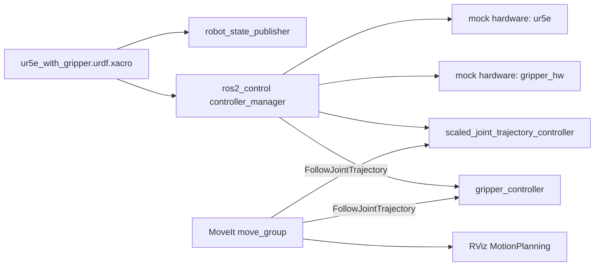

# UR5e + Simple Parallel Gripper — ROS 2 Jazzy / MoveIt 2

Simulation of a Universal Robots **UR5e** collaborative arm equipped with a **custom parallel gripper**, planned and controlled with **MoveIt 2** and **ros2_control**. The whole stack starts with a single launch command.

## Features

- Custom parallel gripper described in xacro: one actuated finger, the second one follows through a `mimic` joint
- Gripper attached to the UR5e `tool0` frame and merged with the official UR driver description
- Simulated hardware with `ros2_control` (`mock_components/GenericSystem`) for both the arm and the gripper
- Dedicated MoveIt 2 configuration with two planning groups (`ur_manipulator`, `gripper`), an end effector and named states (`home`, `up`, `open`, `close`)
- One-command bringup: UR driver, gripper controller, MoveIt 2 and RViz
- Developed and tested on Windows 11 through WSL2 (Ubuntu 24.04), no dual boot or virtual machine needed

## Repository structure

```
.
├── ur5e_gripper_description/
│   ├── urdf/
│   │   ├── simple_gripper.xacro           # gripper macro (palm, 2 fingers, TCP, ros2_control)
│   │   └── ur5e_with_gripper.urdf.xacro   # UR5e + gripper assembly
│   └── config/
│       └── ur5e_gripper_controllers.yaml  # UR controllers + gripper_controller
├── ur5e_gripper_moveit_config/
│   ├── srdf/                              # semantic description (groups, states, collisions)
│   ├── config/                            # MoveIt controllers, joint limits, planners, kinematics
│   └── launch/
│       ├── ur5e_gripper_moveit.launch.py  # MoveIt 2 (move_group + RViz)
│       └── ur5e_gripper.launch.py         # full bringup (driver + gripper + MoveIt)
├── LICENSE
└── README.md
```

| Package | Content |
|---|---|
| `ur5e_gripper_description` | Gripper xacro, UR5e + gripper assembly, ros2_control controllers configuration |
| `ur5e_gripper_moveit_config` | SRDF, MoveIt controllers and joint limits, launch files |

## Requirements

- Ubuntu 24.04 (native or WSL2)
- ROS 2 Jazzy

### Using Windows (WSL2)

1. Make sure virtualization is enabled in the BIOS/UEFI.
2. In an administrator PowerShell: `wsl --install -d Ubuntu-24.04`
3. GUI applications (RViz) run through WSLg, which is included in Windows 11 and recent Windows 10 builds.
4. Optional: VS Code with the **WSL** extension, then `code .` from the Ubuntu terminal.

## Installation

```bash
# ROS 2 Jazzy: follow https://docs.ros.org/en/jazzy/Installation.html, then:
sudo apt install ros-jazzy-desktop ros-dev-tools ros-jazzy-ur ros-jazzy-moveit

# Workspace
mkdir -p ~/ros2_ws/src && cd ~/ros2_ws/src
git clone https://github.com/<your-username>/ur5e-gripper-moveit2.git
cd ~/ros2_ws
colcon build --symlink-install
source install/setup.bash
```

## Usage

```bash
ros2 launch ur5e_gripper_moveit_config ur5e_gripper.launch.py
```

This starts, in order:

1. the UR driver with simulated hardware, using this repository's robot description and controllers
2. the gripper controller (spawned after a short delay)
3. MoveIt 2 and RViz

In RViz, open the **MotionPlanning** panel, select the planning group (`ur_manipulator` or `gripper`), choose a goal state (`home`, `up`, `open`, `close`...) and click **Plan & Execute**.

Launch arguments: `ur_type` (default `ur5e`), `launch_rviz` (default `true`), `robot_ip` (dummy value, required by the UR launch file but unused with mock hardware).

### Checking the controllers

```bash
ros2 control list_controllers
ros2 control list_hardware_components
```

`scaled_joint_trajectory_controller` and `gripper_controller` must be `active`, and both `ur5e` and `gripper_hw` must appear as hardware components.

### Moving the gripper without MoveIt

```bash
# close (0.02 m) ; use positions: [0.0] to open
ros2 topic pub --once /gripper_controller/joint_trajectory trajectory_msgs/msg/JointTrajectory \
  "{joint_names: [gripper_finger_left_joint], points: [{positions: [0.02], time_from_start: {sec: 2}}]}"
```

## How it works



- **Description**: `ur5e_with_gripper.urdf.xacro` includes the xacro of `ur_robot_driver` (which also generates the arm's `ros2_control` block) and attaches the gripper to `tool0` with a fixed joint.
- **Gripper**: a palm, two prismatic fingers (0 to 0.02 m, the right one mimics the left one) and a `gripper_tcp` frame. Its own `ros2_control` block uses mock hardware.
- **Controllers**: the UR controllers file is extended with a `gripper_controller` (`JointTrajectoryController`) on `gripper_finger_left_joint`.
- **MoveIt**: the SRDF adds the `gripper` group, the `open` / `close` states, the `gripper_ee` end effector and the collision pairs to ignore. `moveit_controllers.yaml` registers `gripper_controller`, and `joint_limits.yaml` gives the finger velocity and acceleration limits required by time parameterization.
- **Bringup**: `ur5e_gripper.launch.py` includes the driver launch file, spawns `gripper_controller` after a delay, then includes the MoveIt launch file.

## Challenges and lessons learned

- **Arm hardware missing**: the xacro of `ur_description` only describes the geometry. The `ros2_control` block of the arm comes from the xacro of `ur_robot_driver`. Including the wrong one left the arm without joint states (RViz showed "No transform" for every link).
- **File arguments are paths, not package-relative names**: `description_file` and `controllers_file` of the UR launch files are read as paths, so absolute paths are required.
- **Hard-coded MoveIt configuration**: `ur_moveit.launch.py` always loads the SRDF and controllers of `ur_moveit_config`, so a dedicated MoveIt configuration package was needed.
- **Missing acceleration limit**: MoveIt's time parameterization fails if a joint has no acceleration limit, including the gripper finger. The URDF cannot express it, so it is set in `joint_limits.yaml`.
- **Controller startup order**: the gripper controller is not started by the UR driver. It is spawned after the driver with a timer and a timeout, otherwise MoveIt reports that the action server is not connected.
- **Launch argument leakage**: `launch_rviz:=false` given to the included driver launch overrode the value used for MoveIt. Wrapping the driver include in a `GroupAction` keeps its arguments scoped.

## Known limitations

- Simulation only (mock hardware): no physics engine and no object interaction.
- The gripper opening is about 4 cm.
- Only the UR5e is configured.
- Tested on Ubuntu 24.04 under WSL2 with ROS 2 Jazzy. Warnings about real-time scheduling and controller manager overruns are expected under WSL2 and are harmless in simulation.

## Roadmap

- [ ] Pick-and-place demo with a table and an object in the planning scene
- [ ] Wider gripper opening
- [ ] Gazebo simulation

## License

MIT, see [LICENSE](LICENSE).

## Author

Yoann Grasperger, ygraspergerpro@gmail.com
